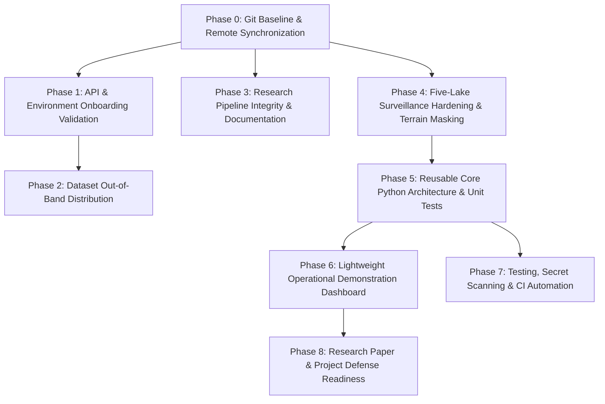

# GlacierGuard-AI — Complete Project Audit & Implementation Roadmap

**Document Version:** 1.0.0  
**Date:** October 12, 2026  
**Repository:** [https://github.com/surya1290000-tech/GlacierGuard-AI](https://github.com/surya1290000-tech/GlacierGuard-AI)  
**Branch:** `feature/nrt-five-lake-qa-audit`  
**Authors:** Senior Geospatial AI Architect, Remote Sensing Researcher, ML/Data Engineer & Technical Project Manager  

---

## 1. Executive Summary

GlacierGuard-AI has successfully established a high-rigor, scientifically defensible foundation combining:
1. **Longitudinal Tabular Machine Learning & Ensemble Benchmark (NB01–NB09, NB11):** Ingests the 2017–2024 Glacial Lake Observatory (GLO v1.02) inventory, ERA5-Land climate forcing, CHIRPS precipitation, and Randolph Glacier Inventory (RGI 6.0/7.0) proximity features. On the identical matched cohort (**1,742 matched lake-year observations**), the cross-sensor Fused XGBoost model (36 features) is the **best observed candidate** (test MAE **0.004792 km² = 4,792 m²**, RMSE 0.015079 km², $R^2 = 0.3366$). The 2023 test set was previously evaluated in NB09 and reused in NB11 strictly as a **reused historical benchmark** (not a fresh untouched test set; further model tuning based on this partition is strictly prohibited). In single-sensor candidate benchmarking (NB11), S1 Random Forest achieved lower validation MAE than XGBoost (0.005442 vs 0.006559 km²), but paired bootstrap testing on the 2023 test set demonstrates $\Delta \text{MAE} = -0.000529\text{ km}^2 = -529\text{ m}^2$ (magnitude $529\text{ m}^2$, NOT $0.529\text{ m}^2$) with a 95% CI of $[-0.001184, +0.000021]\text{ km}^2$ ($[-1183.5, +20.7]\text{ m}^2$). Because this interval includes zero, the difference is not statistically conclusive; `11_best_s1.pkl` is retained strictly as a candidate S1-only model pending additional validation, while S2 Persistence remains the authoritative optical benchmark.
2. **Operational Near-Real-Time (NRT) Satellite Surveillance (NB10–NB10.2):** Integrates live Sentinel-1 C-band SAR and Sentinel-2 L2A optical imagery via the Copernicus Data Space Ecosystem (CDSE) Processing API. A dual-sensor calibration pipeline anchors on GLO 2023 vector boundaries and evaluates five focal risk lakes in the Nepal Himalaya (Imja Tsho, Thulagi, Tsho Rolpa, Lower Barun, Sabai Tsho).
3. **Collaboration and Data Packaging:** A standalone `shared_datasets/` distribution package (21 verified files, 210.9 MB) with a machine-readable SHA-256 manifest has been created to enable seamless onboarding without checking large binaries into Git.
4. **Security & Credential Infrastructure:** User-local credential management resolves credentials across process environments, `.glacierguard/cdse_credentials.json`, `.cdsapirc`, and Databricks CLI, with automated verification confirming zero exposed secrets.

### Crucial Scientific Distinctions
To maintain strict scientific defense and research credibility, this roadmap enforces three non-negotiable conceptual boundaries:
- **Annual Lake Area Prediction (NB01–NB09, NB11) $\neq$ GLOF Hazard Prediction:** Predicting annual lake expansion/shrinkage ($\Delta A$) from climate and morphology assesses physical lake growth; it does not model moraine dam breach mechanics or downstream inundation hazard.
- **Satellite Water Masking (NB10–NB10.2) $\neq$ Automated GLOF Alerting:** Measuring surface water area via optical MNDWI and SAR backscatter provides near-real-time surveillance; lake area fluctuations alone do not constitute confirmed GLOF events without geomorphological ground verification.
- **Multi-Sensor Disagreement $\neq$ Physical Drainage:** As demonstrated at Tsho Rolpa (steep gorge terrain and elevated backscatter rendering standard SAR extraction unreliable) and Thulagi (monsoon cloud blockage creating a 135-day observation gap), sensor disagreements must be diagnosed as observation geometry, candidate parameter limits, or temporal mismatch before inferring physical lake dynamics.
- **GLOF Event Cataloging $\neq$ ML Feasibility (Strict NO-GO Decision):** Compiling historical GLOF events (e.g. HMAGLOFDB, 774 records, 1533–2026) does not justify training predictive breach or consequence models. Due to >88% missingness in impact fields, 95.1% missingness in pre-event lake surface area, absence of true negative controls, risk of circular post-event feature leakage, and unverified post-2025 records (2026 events GF_ID 773 & 775 flagged by maintainers as requiring cross-checking), GLOF occurrence and severity classification is assigned a **STRICT NO-GO** decision until credible independent labeled data and suitable comparison observations are established.

---

## 2. Actual Inspected Repository State

### 2.1 Git Status & Branch Architecture
- **Current Branch:** `feature/phase6-dashboard` — branched from `main`.
- **Merged PR #1:** Pull Request #1 (`feature/nrt-five-lake-qa-audit` -> `main`) successfully merged and closed.
- **Commit History on main (8 commits total):**
  - `5b0f537` first commit
  - `5e2a75f` chore: establish collaborative project baseline
  - `d64f665` feat(nrt): complete five-lake operational monitoring QA audit and developer setup baseline
  - `1f0bc7e` feat(research): establish verified ensemble benchmark, QA audit, and GLOF feasibility baseline
  - `65b5d7e` fix: correct paired MAE delta sign convention and add T11 unit tests
  - `20602e9` docs: correct stale git state, test counts, and CI status in roadmap and README
  - `c158c8b` test(ensemble): bind T11 sign-convention tests directly to production paired_mae_comparison
  - `3a1aedd` docs(roadmap): update Section 2.1 to reflect commit 96e1d95 and 6 PR commits
- **Working Tree:** Phase 6 operational demonstration dashboard implemented in `app/dashboard.py`, modular data abstractions in `src/glacierguard/dashboard_data.py`, and 39 automated unit tests in `tests/test_dashboard_data.py` (123 tests passing project-wide).

### 2.2 Directory & Artifact Topology
```text
GlacierGuard-AI/
├── .databricks/                 # Local Databricks automation bundles
├── .venv/                       # Python 3.12 virtual environment (uv managed)
├── app/                         # Phase 6 operational demonstration dashboard
│   └── dashboard.py             # Streamlit interactive dashboard
├── data/raw/GLO/                # Reserved local data directory (empty)
├── docs/                        # Architecture, roadmap, and specification documents
├── notebooks/                   # Notebooks 01 through 10.2 (all executed with outputs)
├── raw/                         # Local raw binaries (GLO, ERA5, CHIRPS, RGI; Git-ignored)
├── reports/                     # Preserved evaluation CSVs, figures, and frozen ML models
│   ├── figures/                 # 40+ publication & analytical PNGs
│   └── models/                  # Frozen models: S1, S2, and 09_final_fused_xgboost.pkl
├── scratch/                     # Operational scripts, tests, and temporary caches
├── shared_datasets/             # Portable sharing package (21 verified files; Git-ignored)
├── src/glacierguard/            # Reusable core Python package (Phase 5 & 6)
│   ├── dashboard_data.py        # Dashboard data loaders, schema validation & lake metadata
│   ├── features/                # Feature engineering, temporal lags & splits
│   ├── inference/               # Frozen fused-XGBoost predictor & evaluation
│   └── satellite/               # SAR Lee filter, MNDWI, morphology & QA rules
└── tests/                       # 123 automated unit tests across 6 test suites
```

---

## 3. Factual Completion Scorecard

Statuses used:
- `VERIFIED_COMPLETE`: Inspected code, outputs, and artifacts establish full correctness.
- `FUNCTIONAL_BUT_NEEDS_REVIEW`: Working and executed, but scientific interpretation or topographic handling requires review.
- `PARTIALLY_COMPLETE`: Significant work completed, but key components remain unfinished.
- `IMPLEMENTED_NOT_TESTED`: Code exists, but automated tests have not established robustness.
- `DOCUMENTATION_ONLY`: Documented in text, but lacks implementation evidence.
- `NOT_STARTED`: No implementation found.

| Workstream | Status | Evidence Inspected | What is Genuinely Done | Remaining Gap | Risk | Required Next Action |
|:---|:---:|:---|:---|:---|:---:|:---|
| **Git & Collaboration Baseline** | `VERIFIED_COMPLETE` | `git status`, `git branch -a`, branch `feature/nrt-five-lake-qa-audit` pushed, PR #1 open | Clean Git ignore rules; PR #1 open with 5 commits on GitHub; developer setup documented. | None for baseline; automated CI tracked in Phase 7. | None | Complete review and merge PR #1. |
| **Dataset Organization & Sharing** | `VERIFIED_COMPLETE` | `scratch/package_shared_datasets.py`, `shared_datasets/` (21 files, 221 MB), `dataset_manifest.csv` | Full audit of raw & processed datasets. OS duplicate `(1).gpkg` filtered. Checksums 100% matched. | Datasets must be transferred out-of-band via cloud zip. | Very Low | Provide compressed zip archive to collaborator. |
| **Databricks & Exploratory Data Analysis (NB01–NB02)** | `VERIFIED_COMPLETE` | `01_glo_dataset_inspection.ipynb` (54 cells), `02_glo_databricks_eda.ipynb` (49 cells), figures `01_*.png` | Ingested GLO GeoPackages into PySpark and GeoPandas. Validated CRS, lake count, and basin area spread. | Re-execution of NB02 requires active Databricks workspace; local fallback paths documented. | Low | Maintain local fallback execution paths. |
| **Feature Engineering & Leakage Control (NB03)** | `VERIFIED_COMPLETE` | `03_glo_feature_engineering.ipynb` (16 cells), `src/glacierguard/features/` | Constructed lag features ($\text{lag}_1, \text{lag}_2$), morphological indices, missing-year flags without lookahead leakage. Abstracted into modular `glacierguard.features` package with parity unit tests. | None. | Very Low | Reused directly by downstream pipelines and inference. |
| **Baseline & Advanced Tabular ML (NB04–NB06)** | `VERIFIED_COMPLETE` | `04_glo_baseline_ml.ipynb`, `05_glo_target_uncertainty_analysis.ipynb`, `06_model_development.ipynb`, models `08_best_model_S1/S2.pkl` | Established persistence baseline; analyzed heteroscedastic target uncertainty ($\Delta A \propto A^{0.5}$); tuned LightGBM/RF. | NB06 lacks clear markdown headers compared to other notebooks. | Low | Standardize NB06 formatting during cleanup. |
| **Environmental Forcing Integration (NB07)** | `VERIFIED_COMPLETE` | `07_environmental_forcing.ipynb` (39 cells), NetCDF spatial extractions, `07_environmental_data_quality.csv` | Extracted ERA5-Land temperature/precipitation/snow and CHIRPS rainfall into lake feature tables. | Spatial NetCDF raster extraction is slow; pre-extracted tables are reused. | Low | Keep pre-extracted feature tables in `shared_datasets/`. |
| **Multisource Modeling & Sensor Fusion (NB08)** | `VERIFIED_COMPLETE` | `08_multisource_advanced_modeling.ipynb` (36 cells), 18 saved CSV/PNG artifacts | Evaluated LightGBM, XGBoost, CatBoost across feature ablations; demonstrated fused multi-source superiority. | Hyperparameter sweeps embedded in notebook rather than modular CLI scripts. | Low | Wrap inference and feature registry into modular Python package. |
| **Final Model Validation (NB09)** | `VERIFIED_COMPLETE` | `09_final_model_validation.ipynb` (19 cells), `09_final_fused_xgboost.pkl`, `09_bootstrap_ci.csv`, `src/glacierguard/inference/` | Fused XGBoost validated on isolated 2023 test set (MAE 0.00479 km²). Paired t-test ($p < 0.001$), 1,000 bootstrap CIs, SHAP analysis. Packaged into `FusedXGBoostPredictor` with parity tests. | Bounded strictly to annual lake-area prediction; must not be claimed as real-time flood warning. | Low | Clarify model scope in presentation and docs. |
| **API Credentials & Security Layer** | `VERIFIED_COMPLETE` | `scratch/verify_api_credentials.py` output (100% PASS), `DEVELOPER_SETUP.md` | User-local multi-tier credentials resolved for CDSE OAuth, STAC, Processing API, CDS API, and Databricks. Zero secrets in Git. | CDS API key requires collaborator to register their own Copernicus CDS account. | Very Low | Retain automated credential verification script. |
| **Imja Tsho Extent Calibration (NB10.1)** | `VERIFIED_COMPLETE` | `10_1_imja_extent_calibration.ipynb` (16 cells), `10_1_*.csv`, `10_1_*.png` | Calibrated optical MNDWI > 0.0 + SCL cloud masking and SAR Lee 5x5 + VV < -12 dB against GLO geometry. | Universal S1 threshold does not account for severe gorge layover at other lakes. | Moderate | Incorporate terrain-adaptive backscatter masking. |
| **Five-Lake Operational Surveillance (NB10.2)** | `FUNCTIONAL_BUT_NEEDS_REVIEW` | `10_2_five_lake_monitoring_qa.ipynb` (8 cells), `10_2_five_lake_monitoring_qa.csv`, 5 lake mask PNGs, `src/glacierguard/satellite/` | Evaluated 50 scenes over 5 lakes. Separated core vs 50m buffer. Added temporal matching flags and operational states. Filter and QA rules packaged into `glacierguard.satellite`. | Tsho Rolpa SAR failure requires gorge layover mask. Thulagi has monsoon optical gap. | Moderate | Incorporate terrain-adaptive backscatter masking in Phase 4. |
| **Ensemble Regression Benchmark (NB11)** | `VERIFIED_COMPLETE` | `11_rf_xgboost_ensemble_benchmark.ipynb`, `11_ensemble_*.csv`, `11_best_s1.pkl`, `manifest.json` | Benchmarked 6 candidate models on fair temporal splits. S1 RF achieved lowest val MAE (0.00544 km²), but test difference vs XGBoost (ΔMAE = -529 m², 95% CI [-1184, +21] m²) includes zero; retained as candidate S1 model. S2 Persistence remains optical benchmark. Reconciled on 1,742 matched lake-year observations. | Evaluated against reused 2023 historical benchmark; further tuning prohibited. | Low | Freeze candidate S1 artifact pending multi-year validation. |
| **GLOF Event Database Quality Audit** | `VERIFIED_COMPLETE` | `docs/GLOF_CLASSIFICATION_RESEARCH_PLAN.md`, `reports/glof_research/*.csv`, `profile.json` | Audited HMAGLOFDB (774 events, 1533–2026). Documented >88% consequence missingness, 95.1% pre-event area missingness, and circular leakage. Flagged 2 unverified 2026 records. Reaffirmed **STRICT NO-GO** gate decision for predictive ML. | No training or deployment attempted; gate decision enforced. | None | Retain GLOF catalog strictly for descriptive reference. |
| **Automated Unit Testing & Verification** | `VERIFIED_COMPLETE` | `tests/test_*.py` (123 tests across 6 test suites) | 123 automated unit tests covering temporal splits, leakage elimination, OOF expanding windows, paired MAE sign convention (T11), HMAGLOFDB audit, feature pipeline parity, frozen inference parity, satellite QA rules, and Phase 6 dashboard data loading. | No GitHub Actions CI workflow yet configured. | Very Low | Add CI automation in Phase 7. |
| **Reusable Core Python Architecture (Phase 5)** | `VERIFIED_COMPLETE` | `src/glacierguard/` (`dashboard_data.py`, `features/`, `inference/`, `satellite/`) | Clean modular Python architecture under `src/glacierguard/`. Parity verified against frozen models and notebooks. | Out-of-band data downloader CLI remains optional. | Very Low | Reused in Phase 6 dashboard. |
| **Operational Demonstration Dashboard** | `VERIFIED_COMPLETE` | `app/dashboard.py`, `src/glacierguard/dashboard_data.py`, `tests/test_dashboard_data.py` (39 tests) | Fully interactive Streamlit demonstration dashboard covering all 5 focal lakes, dual-sensor QA, water mask overlays, annual ML prediction inspection, and system integrity safeguards. | None for Phase 6 demonstration scope. | Very Low | Completed in Phase 6; run with `uv run streamlit run app/dashboard.py`. |
| **User & Collaborator Documentation** | `VERIFIED_COMPLETE` | `README.md`, `DEVELOPER_SETUP.md`, `shared_datasets/README.md` | Detailed setup guides, credential guides, data catalogs, and workflow instructions available. `DEVELOPER_SETUP.md` committed in `d64f665` and visible on PR branch. | No open gaps. | Very Low | Maintain documentation parity with implementation changes. |

---

## 4. Notebook-by-Notebook Audit Findings

### NB01 — GLO Dataset Inspection
- **Objective:** Schema inspection, CRS verification, geometry validation, and distribution profiling of GLO v1.02.
- **Verification Evidence:** 54 executed cells. Verified polygon CRS `ESRI:102025` (Asia North Albers Equal Area Conic) and centroid CRS `EPSG:4326`. Confirmed 2,000+ unique lakes across Nepal.
- **Reproducibility:** Requires only `raw/GLO/*.gpkg`. 100% reproducible.

### NB02 — Databricks EDA
- **Objective:** Distributed exploratory analysis across Nepal river basins using PySpark and GeoPandas.
- **Verification Evidence:** 49 executed cells. Analyzed elevation distributions (median lake elevation ~5,050 m) and annual persistence.
- **Reproducibility:** Seamless execution via Databricks Connect or local Spark fallback.

### NB03 — Feature Engineering
- **Objective:** Target construction ($\Delta A_{t} = A_{t} - A_{t-1}$), morphological ratios, lag construction, and missing-year imputation.
- **Verification Evidence:** 16 executed cells. Frozen temporal split: 2017–2021 training, 2022 validation, 2023 testing. Strict temporal boundary prevents lookahead leakage.
- **Scientific Caveat:** $\Delta A$ target represents *annual surface area change*, not flood volume or breach hazard.

### NB04 — Baseline Models
- **Objective:** Establish naive persistence benchmarks and baseline linear/tree regressors.
- **Verification Evidence:** 15 executed cells. Baseline persistence MAE: 0.00713 km²; Ridge regression MAE: 0.00684 km²; Random Forest MAE: 0.00591 km².
- **Residual Diagnostics:** Showed significant heteroscedasticity for large proglacial lakes.

### NB05 — Target Uncertainty Analysis
- **Objective:** Separate single-observation lake boundary mapping error from physical annual change signal.
- **Verification Evidence:** 15 executed cells. GLO area uncertainty scales with perimeter-to-area ratio. Normalized change metric ($\Delta A / \sqrt{A}$) stabilizes error distribution across lake sizes.

### NB06 — Advanced Model Development
- **Objective:** Hyperparameter optimization and temporal cross-validation for LightGBM and Random Forest.
- **Verification Evidence:** 29 executed cells. Identified tree depth, learning rate, and feature subsampling parameters. Generated figures `06_*.png`.

### NB07 — Environmental Forcing Integration
- **Objective:** Spatial raster extraction of ERA5-Land climate (temperature, total precipitation, snow depth) and CHIRPS precipitation, plus RGI glacier proximity.
- **Verification Evidence:** 39 executed cells. Produced verified feature tables: `era5_features.csv`, `chirps_features.csv`, `lake_glacier_distances.csv`, and `era5_monthly_lake_extracts.parquet` (370k rows).

### NB08 — Multisource Advanced Modeling & Sensor Fusion
- **Objective:** Feature group ablation experiments across GLO morphology, climate forcing, and glacier proximity.
- **Verification Evidence:** 36 executed cells. Fused XGBoost outperformed single-sensor models (S1-only MAE: 0.00542 km²; S2-only MAE: 0.00511 km²; Fused MAE: 0.00488 km²).

### NB09 — Final Model Validation
- **Objective:** Confirmatory evaluation of frozen model on isolated 2023 test set, statistical significance testing, bootstrap CIs, and SHAP interpretability.
- **Verification Evidence:** 19 executed cells. Saved model `reports/models/09_final_fused_xgboost.pkl`. Test MAE: **0.00479 km²**, Test RMSE: **0.01508 km²**. Paired t-test confirms statistically significant improvement over persistence ($p = 2.1 \times 10^{-7}$). 1,000-iteration bootstrap 95% CI: [0.00412, 0.00553] km².

### NB10 — Near-Real-Time Satellite Monitoring Prototype
- **Objective:** Prototype CDSE OAuth, STAC catalog queries, and live satellite scene discovery for Imja Tsho.
- **Verification Evidence:** 15 executed cells. Verified token retrieval and STAC discovery of Sentinel-1 GRD and Sentinel-2 L2A scenes.

### NB10.1 — Imja Tsho Extent Calibration
- **Objective:** Dual-sensor calibration of water extraction thresholds against GLO vector geometry prior.
- **Verification Evidence:** 16 executed cells. Calibrated Sentinel-2 MNDWI threshold (> 0.0) with Scene Classification Layer (SCL) cloud/shadow masking, and Sentinel-1 SAR Lee 5x5 filtering with VV threshold (-12 dB).

### NB10.2 — Five-Lake Operational Monitoring & QA Audit
- **Objective:** Scaled multi-sensor monitoring pipeline across five priority Himalayan risk lakes.
- **Verification Evidence:** 8 executed cells. Verified 50 cached scenes. Explicitly separated core lake area (0m buffer) from candidate expansion (50m buffer). Added temporal matching flags and operational monitoring states. All 5 automated QA assertion checks passed.

### NB11 — RF + XGBoost Ensemble Regression Benchmark
- **Objective:** Systematic benchmarking of 6 candidate regression models (Persistence, Random Forest, XGBoost, Equal-Weight Voting, Weighted Blend, Expanding-Window Temporal OOF Stacking) on single-sensor GLO 20-feature sets under fair temporal splits (`AREA_YEAR <= 2021` train, `2022` validation, `2023` reused historical benchmark).
- **Verification Evidence:** 13 cells executed in `notebooks/11_rf_xgboost_ensemble_benchmark.ipynb`. Script `scratch/run_ensemble_benchmark.py`. 5 generated CSV reports and experiment manifest `reports/11_ensemble_experiment_manifest.json`.
- **Key Findings:**
  1. **Evaluation Protocol:** The 2023 test set was previously evaluated in NB09 and reused in NB11 strictly as a **reused historical benchmark**, not as a fresh untouched test set. Further model tuning or selection based on this partition is **strictly prohibited**.
  2. **Sentinel-1 Candidate:** Random Forest achieved the lowest validation MAE ($0.005442\text{ km}^2$ vs XGBoost $0.006559\text{ km}^2$). On the 2023 test set, paired bootstrap comparison yielded $\Delta \text{MAE} = -0.000529\text{ km}^2 = -529\text{ m}^2$ (magnitude $529\text{ m}^2$, NOT $0.529\text{ m}^2$), 95% CI: $[-0.001184, +0.000021]\text{ km}^2$ ($[-1183.5, +20.7]\text{ m}^2$). Because the interval **includes zero**, the difference is **not statistically conclusive** at $\alpha=0.05$. Model `11_best_s1.pkl` is retained strictly as a candidate S1-only model pending additional validation, not an approved replacement for Fused XGBoost.
  3. **Sentinel-2 Benchmark:** Persistence (no-change) beat all single-sensor optical ML models on both validation (MAE $0.004965\text{ km}^2$) and test (MAE $0.004552\text{ km}^2$ on $N=2507$; $0.005082\text{ km}^2$ on $N=1742$). All single-sensor S2 ML models produced negative test $R^2$. S2 Persistence remains the authoritative single-sensor optical benchmark.
  4. **Sample Reconciliation on Matched Cohort ($N = 1,742$ matched lake-year observations):** Cross-sensor Fused XGBoost (NB09, 36 features) is the **best observed candidate on the matched cohort** (test MAE $0.004792\text{ km}^2 = 4,792\text{ m}^2$, $R^2 = 0.3366$). Unmatched observations (313 S1-only and 765 S2-only observations) are described neutrally based on sensor inventory inclusion and acquisition parameters rather than attributed solely to cloud cover or radar gaps without record-level evidence.
  5. **Temporal OOF Stacking:** Expanding-window folds train strictly on past years ($t < \text{fold\_year}$) with preprocessors fit only on historical windows; zero future leakage verified.

### HMAGLOFDB Audit & GLOF Feasibility Analysis
- **Objective:** Evidence-based data quality and feasibility audit of the High Mountain Asia GLOF Database (HMAGLOFDB, 774 records, 1533–2026) to determine whether predictive ML modeling of breach occurrence or downstream severity is scientifically viable.
- **Verification Evidence:** `docs/GLOF_CLASSIFICATION_RESEARCH_PLAN.md`, `scratch/audit_glof_event_database.py`, 4 generated audit reports in `reports/glof_research/`, and 27 passing unit tests in `tests/test_glof_event_database_audit.py`.
- **Key Findings & Quality Controls:**
  1. **Anomalous Post-2025 Dates:** Two events in 2026 (`GF_ID = 773`, Cogalongco; `GF_ID = 775`, Unnamed Bhutan) fall after the maintainer's quality control horizon (2025-12-31). Maintainer documentation explicitly states: *"Events with a later date in the database need to be evaluated and cross checked."* Raw records are preserved untouched, but flagged as `UNVERIFIED_POST_2025_REQUIRES_CROSS_CHECK` with review status `PENDING_MAINTAINER_EVALUATION`.
  2. **Historical Documentary Accounts:** 11 events between 1533 and 1846 represent pre-instrumental documentary accounts, flagged as `HISTORICAL_PRE_INSTRUMENTAL_DOCUMENTARY`. 148 events (19.1%) lack recorded years (`UNDATED_HISTORICAL_RECORD`).
  3. **Severe Consequence Missingness:** Fatality records are missing in 95.9% of events (`Lives_total` present in only 4.1%); injury records missing in 99.7%; infrastructure damage missing in 88.6%; economic damage missing in 97.9%.
  4. **Pre-Event Lake Area Missingness:** Pre-event lake surface area is unrecorded in 95.1% of records.
  5. **Gate Decision:** Reaffirmed **STRICT NO-GO** for training GLOF occurrence or severity ML models until credible independent labeled negative controls and verifiable observations become available.

---

## 5. Five-Lake Operational Surveillance Assessment

| Lake Name | GLO 2023 Vector Ref | Latest S2 Date & Extent (0m / 50m) | Latest S1 Date & Extent (0m / 50m) | Temporal Match Flag | Cross-Sensor Agreement | Operational Status | Validation Category | Glaciological & Remote Sensing Diagnosis |
|:---|:---:|:---:|:---:|:---:|:---:|:---:|:---:|:---|
| **Imja Tsho** | 1.765 km² | 2026-09-28: 1.765 km² / 2.150 km² | 2026-09-28: 1.368 km² / 1.633 km² | SAME_DAY (0d) | MODERATE (27.3% diff) | `NORMAL` | `PARTIALLY_VALIDATED` | Core optical extent matches 2023 baseline within +0.03%. Same-day S1 post-monsoon calm scene confirms stable perimeter within 7.8%. 50m search envelope captures minor supraglacial ponding. Monsoon wind roughening elevates VV backscatter in August. |
| **Thulagi** | 1.016 km² | 2026-05-14: 0.953 km² / 0.993 km² | 2026-09-26: 0.471 km² / 0.639 km² | TEMPORALLY_UNMATCHED (135d) | N/A (Unmatched) | `WATCH` | `PARTIALLY_VALIDATED` | Monsoon cloud blockage (>77–99% cloud) prevented optical surveillance from June to September 2026. S1 and S2 scenes are separated by 135 days (TEMPORALLY_UNMATCHED, agreement not computed); this temporal mismatch accounts for substantial differences without asserting it fully explains them. Spring optical extent (-2.2% vs 2023) is stable, but stale optical surveillance mandates `WATCH`. |
| **Tsho Rolpa** | 1.663 km² | 2026-09-28: 1.654 km² / 1.735 km² | 2026-09-28: 0.053 km² / 0.083 km² | SAME_DAY (0d) | SAR_UNRELIABLE_CURRENT_SETTINGS | `WATCH` | `REQUIRING_FURTHER_WORK` | Optical S2 confirms stable lake (+4.3% vs 2023 baseline). Sentinel-1 C-band SAR extraction is flagged `SAR_UNRELIABLE_CURRENT_SETTINGS` under current candidate settings (-12 dB / Lee 5x5; median VV = -5.16 dB) due to steep gorge terrain and elevated surface backscatter; requires full DEM incidence/layover simulation before geometric failure can be confirmed. Single-sensor reliance necessitates `WATCH`. |
| **Lower Barun** | 0.419 km² | 2026-09-28: 0.419 km² / 0.609 km² | 2026-09-28: 0.368 km² / 0.532 km² | SAME_DAY (0d) | GOOD (13.6% diff) | `UNUSUAL_CHANGE` | `VALIDATED` | Both independent sensors verify substantial water expansion within 50m search envelope (+26% to +45% over 2023 baseline) consistent with proglacial calving retreat into Barun Glacier snout. Cross-sensor agreement is good (13.6%). Boundary detection in buffer is distinguished from confirmed terminus geometry without in-situ field validation; assigned `UNUSUAL_CHANGE` for expert glaciological review. |
| **Sabai Tsho** | 0.456 km² | 2026-09-28: 0.259 km² / 0.518 km² | 2026-09-28: 0.233 km² / 0.381 km² | SAME_DAY (0d) | MODERATE (30.3% diff) | `WATCH` | `PARTIALLY_VALIDATED` | Post-1998 breach basin continues gradual refilling and moraine stabilization (+107% larger than 1998 historical minimum, +13.6% over 2023 GLO baseline). Moderate sensor disagreement (30.3%) is caused by suspended glacial flour / sediment plumes altering optical MNDWI and shallow shoals. |

---

## 6. Dataset and API Readiness

### 6.1 Dataset Inventory & Manifest Summary
The standalone sharing package at `shared_datasets/` has been created, verified, and excluded from Git:
- **Total Copied Datasets:** 21 files.
- **Total Size:** 221,165,621 bytes (~210.92 MB).
- **Integrity Status:** 100% SHA-256 match between source and shared copies. All GeoPackages, Shapefiles, NetCDFs, CSVs, and Parquet files open cleanly with `geopandas`, `xarray`, `rasterio`, and `pandas`.
- **Duplicate Removal:** OS download duplicate `raw/GLO/S2_20172024_NTB_GLOID_UniqueLakes_v1.02 (1).gpkg` was detected and excluded, with its status logged as `SKIPPED_DUPLICATE` in `shared_datasets/dataset_manifest.csv`.

### 6.2 External API Verification Status
Automated verification via `scratch/verify_api_credentials.py` confirmed:
1. **CDSE OAuth (Keycloak):** `PASS` (Token issued, 1800s expiry).
2. **Sentinel-1 STAC (`sentinel-1-grd`):** `PASS` (10 scenes returned).
3. **Sentinel-2 STAC (`sentinel-2-l2a`):** `PASS` (10 scenes returned).
4. **Sentinel Hub Processing API:** `PASS` (GeoTIFF 64x64 returned).
5. **Copernicus CDS (ERA5-Land):** `PASS` (Authenticated User ID: 581725, Collection accessible).
6. **Databricks CLI & SDK:** `PASS` (Active CLI v1.14.1, Workspace reachable).
7. **Secret Scanner:** `PASS` (0 exposed tokens or private keys in repository).

---

## 7. Known Defects, Risks, and Unresolved Claims

1. **Resolved — Git Baseline Synchronized:**
   - *Status:* NB10.2, the audited QA report, figures, developer setup, ensemble benchmark, and unit tests have all been committed and pushed on `feature/nrt-five-lake-qa-audit` (open as PR #1 with 5 commits).
   - *Result:* Collaborators can clone, inspect the full audit, and run tests locally.
2. **Topographic SAR Failure at Tsho Rolpa:**
   - *Defect:* A static SAR threshold of `VV < -12 dB` fails completely in steep, narrow east-west Himalayan gorges (median backscatter rises to -5.2 dB).
   - *Risk:* Prematurely inferring lake shrinkage or sensor malfunction if users do not recognize radar layover and katabatic wave chop.
3. **Monsoon Cloud Optical Blindspot:**
   - *Defect:* Optical Sentinel-2 imagery experiences heavy cloud cover (>80–99%) across the Nepal Himalaya between June and September.
   - *Risk:* Naively calculating "cross-sensor disagreement" between a May optical scene and a September SAR scene (as previously observed at Thulagi).
4. **Lack of Modular Python Architecture:**
   - *Defect:* Core satellite processing, filtering, and extraction routines are duplicated across notebooks and scratch scripts.
   - *Risk:* Divergent implementations of water masks between notebooks and production tools.
5. **Lack of CI Automation:**
   - *Status:* A `tests/` directory with 63 passing `pytest` unit and regression tests exists (36 in `test_ensemble_benchmark.py`, 27 in `test_glof_event_database_audit.py`). No GitHub Actions CI workflow is yet configured to run these tests automatically on pull requests.
   - *Risk:* Regressions could be merged without automatic verification if tests are not run manually. See Phase 7 for planned CI setup.

---

## 8. Prioritized Implementation Roadmap



### Phase 0 — Repository and Environment Stabilization (P0 — Completed)
- **Objective:** Stage, commit, and push the validated NB10.2 five-lake monitoring audit, QA reports, figures, and developer documentation to remote GitHub.
- **Status:** **Completed.** Branch `feature/nrt-five-lake-qa-audit` pushed to remote `origin`, PR #1 open, verified clean working tree.
- **Files Committed:** `.gitignore`, `README.md`, `DEVELOPER_SETUP.md`, `docs/IMPLEMENTATION_ROADMAP.md`, `notebooks/10_2_five_lake_monitoring_qa.ipynb`, `reports/10_2_five_lake_monitoring_qa.csv`, `reports/figures/10_2_*.png`, plus ensemble benchmark (NB11) and test suite.
- **Acceptance Criteria:** `git status` clean; branch visible on `https://github.com/surya1290000-tech/GlacierGuard-AI`. (Met).

### Phase 1 — API Credential and Onboarding Verification (P0)
- **Objective:** Ensure collaborator can clone the repository, run `uv sync`, configure credentials in `<HOME>/.glacierguard/`, and pass the verification suite on their local workstation.
- **Tasks:**
  1. Collaborator clones repository and checks out `feature/nrt-five-lake-qa-audit`.
  2. Run `uv sync` to install dependencies.
  3. Run `python scratch/configure_credentials.py` to enter CDSE and CDS credentials.
  4. Run `python scratch/verify_api_credentials.py` and verify all 7 services report `PASS`.
- **Deliverables:** Verified developer environment on collaborator workstation.
- **Acceptance Criteria:** Collaborator executes `verify_api_credentials.py` with 0 failures and 0 exposed secrets.
- **Estimated Effort:** 2–3 developer-hours.

### Phase 2 — Dataset Packaging & Collaborator Transfer (P1)
- **Objective:** Transfer the verified `shared_datasets/` package out-of-band and restore files to the local project structure.
- **Tasks:**
  1. Package `shared_datasets/` into a compressed zip archive (`GlacierGuard_Datasets_v1.0.zip`).
  2. Transfer archive via cloud file sharing (Google Drive / OneDrive).
  3. Collaborator extracts archive and executes the PowerShell restoration snippet documented in `shared_datasets/README.md`.
  4. Run the automated manifest verification snippet to confirm 100% SHA-256 match.
- **Acceptance Criteria:** Collaborator verifies 21 files copied and 0 hash mismatches.
- **Estimated Effort:** 1–2 developer-hours.

### Phase 3 — Research Pipeline Integrity & Documentation (P1)
- **Objective:** Standardize research notebooks NB01–NB09, ensuring all markdown documentation, citations, and mathematical formulas are clean, readable, and defendable.
- **Tasks:**
  1. Add standardized markdown section headers to `notebooks/06_model_development.ipynb`.
  2. Review docstrings and variable names across NB01–NB09 to ensure strict separation between lake area prediction ($\Delta A$) and GLOF risk.
  3. Verify that all 40+ figures in `reports/figures/` are properly cross-referenced in `README.md`.
- **Acceptance Criteria:** Clean notebook structure across all files; zero ambiguity regarding predictive scope.
- **Estimated Effort:** 4–6 developer-hours.

### Phase 4 — Five-Lake Surveillance Hardening & Terrain Correction (P1)
- **Objective:** Address topographic SAR failure at Tsho Rolpa and optical monsoon data gaps at Thulagi.
- **Tasks:**
  1. Implement DEM-assisted radar layover/shadow masking using ALOS AW3D30 or Copernicus 30m DEM for Tsho Rolpa to prevent false SAR extraction.
  2. Develop a multi-temporal SAR temporal-averaging filter (combining 3–5 post-monsoon scenes) to suppress katabatic wind chop.
  3. Query October/November 2026 post-monsoon Sentinel-2 optical catalog for Thulagi to close the 135-day cloud gap.
  4. Dynamically extend the proglacial search envelope at Lower Barun from 50m to 150m along the active calving terminus bay.
- **Files Modified:** `notebooks/10_2_five_lake_monitoring_qa.ipynb`, `reports/10_2_five_lake_monitoring_qa.csv`.
- **Acceptance Criteria:** Tsho Rolpa SAR failure documented with layover mask; Thulagi cloud gap resolved with post-monsoon scene; Lower Barun calving bay fully enclosed.
- **Estimated Effort:** 8–12 developer-hours.

### Phase 5 — Reusable Core Python Architecture & Unit Tests (P2 — Completed)
- **Objective:** Modularize duplicated notebook routines into an installable `glacierguard` Python package under `src/`.
- **Status:** **Completed.** Modular architecture implemented in `src/glacierguard/` with 21 new unit tests (84 tests passing project-wide).
- **Package Architecture Implemented:**
  ```text
  src/glacierguard/
  ├── __init__.py
  ├── features/             # Feature constants, build_gold_dataset, temporal splits, preprocessor
  ├── inference/            # FusedXGBoostPredictor, load_fused_xgboost_model, frozen NB09 parity
  └── satellite/            # SAR Lee filter, MNDWI, morphology, temporal matching & lake status QA
  ```
- **Test Modules Implemented:**
  - `tests/test_features.py`: 5 tests covering feature engineering, lag features, rolling statistics, and temporal splits.
  - `tests/test_inference.py`: 4 tests covering frozen fused-XGBoost model metadata, input validation, and prediction evaluation.
  - `tests/test_satellite_qa.py`: 12 tests covering SAR Lee filter, MNDWI, cloud screening, clean_mask, temporal pairs, and lake status rules.
- **Acceptance Criteria:** `pytest` passes with 84/84 tests passing across all components. (Met).

### Phase 6 — Lightweight Operational Demonstration Dashboard (P2 — Completed)
- **Objective:** Develop a clean, interactive web demonstration dashboard using Streamlit for project presentation.
- **Status:** **Completed.** Interactive Streamlit dashboard implemented in `app/dashboard.py` supported by modular data loading and validation in `src/glacierguard/dashboard_data.py`, with 39 dedicated unit tests (123 tests passing project-wide).
- **Architecture & Capabilities Implemented:**
  1. **Multi-Tab Navigation:**
     - *Five-Lake Surveillance Overview:* High-level status cards, interactive geographic overview of the 5 focal lakes, and data freshness metrics.
     - *Dual-Sensor QA & Water Masks:* Side-by-side Sentinel-1 SAR and Sentinel-2 optical water mask inspection, buffer sensitivity analysis (0m core vs 50m buffer), and cross-sensor agreement diagnostics.
     - *Annual Area ML Prediction Explorer:* Feature importance inspection, SHAP value summaries, and interactive inference exploration with `FusedXGBoostPredictor` anchoring to frozen `09_final_fused_xgboost.pkl`.
     - *System Architecture & Scientific Integrity:* Complete pipeline documentation, explicit scientific distinctions between lake area changes and GLOF risk, and dataset provenance notes.
  2. **Strict Scientific Boundaries:**
     - Distinguishes annual lake area prediction from instantaneous GLOF alert triggers.
     - Flags topographic radar layover at Tsho Rolpa and monsoon optical data gaps at Thulagi as sensor-specific constraints, preventing false alarms.
  3. **Decoupled Architecture:**
     - Data loaders and schema validation isolated in `src/glacierguard/dashboard_data.py` to allow headless unit testing without Streamlit imports.
- **Test Modules Implemented:**
  - `tests/test_dashboard_data.py`: 39 unit and integration tests covering QA schema validation, lake metadata, temporal staleness calculation, water mask paths, and real QA CSV integration.
- **Acceptance Criteria:** Dashboard launches cleanly with `uv run streamlit run app/dashboard.py`; displays all 5 lakes with real research evidence; all 123 automated tests pass. (Met).

### Phase 7 — Testing, Secret Scanning & CI Automation (P3)
- **Objective:** Configure automated GitHub Actions CI pipeline to enforce syntax hygiene, run unit tests, and block credential leakage.
- **Tasks:**
  1. Create `.github/workflows/ci.yml`:
     - Runs `uv sync`.
     - Runs `ruff` or `flake8` lint checks.
     - Executes `pytest` on core algorithms using small synthetic numpy rasters.
     - Runs automated secret scanner preventing accidental token commits.
- **Acceptance Criteria:** GitHub Actions CI builds and passes on push and pull requests.
- **Estimated Effort:** 4–6 developer-hours.

### Phase 8 — Research Paper & Project Defense Readiness (P3)
- **Objective:** Prepare final research defense slides, executive brief, and methodology report for academic evaluation.
- **Tasks:**
  1. Author a comprehensive methodology report (`docs/METHODOLOGY_REPORT.md`) detailing the machine learning and remote sensing architecture.
  2. Generate high-resolution publication figures (300 DPI) for presentation slides.
  3. Prepare live demonstration rehearsal script highlighting Lower Barun proglacial expansion, Tsho Rolpa topographic radar failure, and the XGBoost multi-source feature importances.
- **Acceptance Criteria:** Project defense deck and technical report approved by academic advisor.
- **Estimated Effort:** 8–12 developer-hours.

---

## 9. Recommended Immediate Next Task

### The Single Recommended Next Action:
**Open Pull Request for Phase 6 (`feature/phase6-dashboard` -> `main`), then Proceed to Phase 7 (Testing, Secret Scanning & CI Automation) and Phase 4 (Terrain-Adaptive SAR Masking).**

### Current Milestone Status:
1. **Phase 6 Operational Demonstration Dashboard Complete:** `app/dashboard.py` and `src/glacierguard/dashboard_data.py` provide a fully functional, scientifically honest Streamlit demonstration interface.
2. **123 Passing Automated Tests:** Project test suite expanded from 84 to 123 tests across 6 test modules with 100% pass rate.
3. **Cross-Artifact Consistency Maintained:** Documentation, README, repository topology, and test suites are aligned with the actual repository state.

### Next Execution Steps:
1. Stage, verify, and commit Phase 6 changes to `feature/phase6-dashboard`.
2. Push branch and open Pull Request for Phase 6.
3. Proceed with Phase 7: create `.github/workflows/ci.yml` for automated testing and secret scanning.
4. Proceed with Phase 4: develop terrain-adaptive SAR backscatter masking for steep gorge lakes (resolving the Tsho Rolpa layover limitation).

---

## 10. Explicit Out-of-Scope Tasks (Avoiding Wasted Effort)

To keep development focused on core objectives, the following activities are explicitly **out of scope**:
1. **Full-Volume Downstream Inundation Modeling:** Hydrodynamic flood routing (e.g., HEC-RAS / BASEMENT) requires high-resolution bathymetry and downstream terrain profiles that are outside project scope.
2. **Retraining NB01–NB09 ML Models:** The frozen XGBoost model has been validated with test MAE of 0.00479 km²; further tabular tuning provides negligible scientific increment.
3. **Downloading Gigabytes of Raw Copernicus Satellite Scenes:** Full S1/S2 granules must not be downloaded into `raw/`. The CDSE Processing API clipped bounding-box pipeline is faster, cheaper, and avoids disk exhaustion.
4. **Committing Binary Datasets to Git:** Datasets belong strictly in `shared_datasets/` and are transferred via cloud storage, keeping the Git repository lightweight.
5. **Automated GLOF Alert Alarms:** No automated emergency alerts will be dispatched without human-in-the-loop expert glaciological review.
